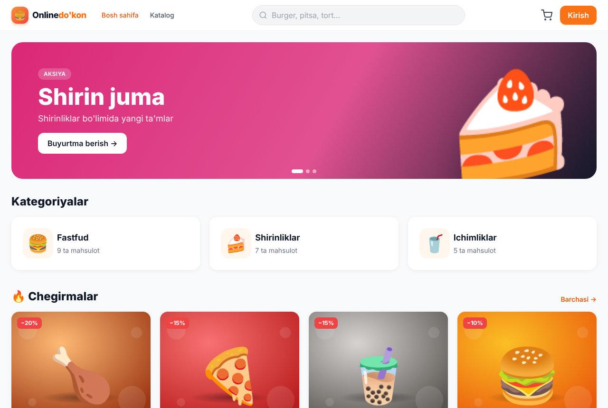

# 🍔 Online do'kon — fastfud va shirinliklar

TATU, RVI002-3 guruhi texnik topshirig'i (TZ) asosida noldan ishlab chiqilgan **to'liq ishlaydigan** onlayn oziq-ovqat do'koni.
Bajardi: Asqarov Azizbek, Raximjonov Kamoliddin, Odiljon Nuriddinov.

| Qism | Texnologiya |
|---|---|
| Frontend | React 18 + Vite + Tailwind CSS (mobile-first, responsive) |
| Backend | Node.js 22 + Express 5 (REST API) |
| Ma'lumotlar bazasi | PostgreSQL 16 |
| Autentifikatsiya | JWT (access 15 daq.) + refresh token (httpOnly cookie, rotatsiya) + bcrypt |
| To'lov | Payme / Click / karta — **sandbox** (imzolangan callback bilan) |
| Deploy | Docker / docker-compose, yoki Ubuntu VPS + PM2 + Nginx + Let's Encrypt |

[](https://render.com/deploy?repo=https://github.com/Aziimuslim/dokon)
[](https://github.com/Aziimuslim/dokon/actions/workflows/ci.yml)



---

## 1. Tez ishga tushirish (lokal)

Talab: **Node.js 20+**, **PostgreSQL 14+**.

```bash
# 1) Baza
sudo -u postgres psql -c "CREATE USER dokon WITH PASSWORD 'dokon123';"
sudo -u postgres psql -c "CREATE DATABASE dokon OWNER dokon;"

# 2) Kutubxonalar
npm run install:all

# 3) Sozlamalar
cp backend/.env.example backend/.env

# 4) Jadvallar + demo ma'lumotlar (21 mahsulot, 3 kategoriya, aksiyalar, foydalanuvchilar)
npm run seed

# 5) Ikki terminalda:
npm run dev:api     # http://localhost:4000  (API)
npm run dev:web     # http://localhost:5173  (sayt)
```

Bitta port bilan (production kabi): `npm run build && npm start` → http://localhost:4000

### Demo hisoblar

| Rol | Login | Parol |
|---|---|---|
| Administrator | `admin@dokon.uz` yoki `+998900000001` | `Admin12345` |
| Kuryer | `courier@dokon.uz` yoki `+998900000002` | `Courier12345` |
| Mijoz | `user@dokon.uz` yoki `+998900000003` | `User12345` |

### Sandbox to'lov ma'lumotlari

| Karta | Natija |
|---|---|
| `8600 0000 0000 0000` | ✅ muvaffaqiyatli |
| `4000 0000 0000 0002` | ❌ mablag' yetarli emas |

Muddat — istalgan (`12/29`), SMS kod — `666666`.

---

## 2. TZ talablari qanday bajarilgan

### Foydalanuvchi rollari (TZ §3)
- **Mehmon** — katalog, qidiruv, savat (brauzerda saqlanadi; kirgandan keyin serverdagi savat bilan birlashadi). Buyurtma uchun ro'yxatdan o'tish talab qilinadi.
- **Mijoz** — savat, checkout, onlayn to'lov, buyurtma holatini kuzatish, profil, manzillar, tarix, bildirishnomalar.
- **Administrator** — `/admin`: hisobotlar, buyurtmalar (holat + kuryer tayinlash), mahsulot CRUD (rasm yuklash, chegirma, mavjudlik), kategoriyalar, aksiyalar, foydalanuvchilar (rol, bloklash).
- **Kuryer** — `/courier`: tayinlangan buyurtmalar, manzil (xaritaga havola), «Yo'lga chiqdim» / «Yetkazildi».

### Modullar (TZ §5) → kod
| Modul | Fayl |
|---|---|
| Autentifikatsiya | `backend/src/routes/auth.js`, `middleware/auth.js`, `middleware/csrf.js` |
| Katalog | `backend/src/routes/catalog.js` |
| Savat | `backend/src/routes/cart.js` |
| Buyurtma | `backend/src/routes/orders.js`, `services/orders.js` |
| To'lov | `backend/src/routes/payment.js`, `services/payment.js` |
| Admin panel | `backend/src/routes/admin.js`, `frontend/src/pages/admin/*` |
| Kuryer | `backend/src/routes/courier.js`, `frontend/src/pages/Courier.jsx` |
| Bildirishnoma | `backend/src/services/notify.js` (ilova ichida + SMS-sandbox log) |

### Buyurtma holatlari
`Qabul qilindi → Tayyorlanmoqda → Yo'lda → Yetkazildi` (+ `Bekor qilindi`). Noto'g'ri o'tishlar serverda rad etiladi; har bir o'zgarish `order_status_history` ga yoziladi va mijozga bildirishnoma yuboriladi. Buyurtma sahifasi holatni har 10 soniyada yangilaydi.

### Sahifalar (TZ §12)
`/` · `/catalog` · `/product/:id` · `/cart` · `/checkout` · `/pay/:id` · `/orders/:id` · `/profile` · `/login` · `/register` · `/admin/*` · `/courier`

---

## 3. Xavfsizlik (TZ §13)

| Talab | Amalga oshirilishi |
|---|---|
| Parol xeshi | `bcrypt` (cost 12). Mavjud bo'lmagan foydalanuvchida ham xesh tekshiriladi (timing hujumidan himoya) |
| JWT sessiya | Access token 15 daq., faqat xotirada (localStorage emas). Refresh token — `httpOnly; SameSite=Strict` cookie, bazada SHA-256 xeshi saqlanadi, **har yangilashda almashtiriladi**; eski token qayta ishlatilsa — barcha sessiyalar bekor qilinadi |
| Summa serverda | Narx, chegirma, yetkazish narxi va jami **faqat serverda** hisoblanadi; mijoz yuborgan `total` e'tiborga olinmaydi |
| Imzo | 1) `POST /api/orders/preview` server hisoblagan kotirovkani **HMAC-SHA256** bilan imzolaydi (15 daq. amal qiladi). 2) `POST /api/orders` imzoni qayta hisoblab tekshiradi — narx yoki savat o'zgargan bo'lsa `409`. 3) Saqlangan buyurtma ham imzolanadi; admin paneli imzo butunligini ko'rsatadi. 4) To'lov provayderi callback'i imzo **va** summa bo'yicha tekshiriladi, idempotent |
| SQL-injection | Barcha so'rovlar parametrlangan (`$1, $2`), saralash — oq ro'yxat |
| XSS | React avtomatik escape + serverda HTML teglarini tozalash + qat'iy CSP (helmet); rasm URL'lari faqat `/uploads/...` yoki `https://` |
| CSRF | API `Authorization: Bearer` sarlavhasi bilan ishlaydi; cookie ishlatadigan endpointlar `SameSite=Strict` + `X-Requested-With` + Origin tekshiruvi |
| Validatsiya | Har bir kiruvchi ma'lumot `zod` sxemasi bilan |
| Rollar | Rol har so'rovda bazadan olinadi; admin/kuryer endpointlari `requireRole` bilan |
| Brute-force | Login/registratsiyaga rate-limit (15 daq.da 20 urinish), umumiy API limit |
| Fayl yuklash | Faqat JPG/PNG/WEBP, 3 MB gacha, tasodifiy nom |
| HTTPS | Nginx + Let's Encrypt, HSTS; production'da cookie `Secure` |
| Sirlar | Production'da standart sirlar bilan server **ishga tushmaydi** |

---

## 4. API (TZ §10)

TZ'dagi barcha endpointlar mavjud (`POST /api/register`, `/api/login`, `GET /api/products`, `/api/products/:id`, `/api/categories`, `POST/GET /api/cart`, `POST/GET /api/orders`, `POST /api/payment`, `POST /api/admin/products`, `PUT /api/admin/orders/:id`) va qo'shimchalari:

```
POST   /api/auth/refresh | /api/auth/logout      GET /api/auth/me     PUT /api/auth/password
GET    /api/promotions
PUT    /api/cart/:productId   DELETE /api/cart/:productId   DELETE /api/cart   POST /api/cart/merge
POST   /api/orders/preview    GET /api/orders/:id   POST /api/orders/:id/cancel
GET    /api/payment/:id       POST /api/payment/callback   (provayder webhook, imzoli)
GET    /api/payment/sandbox/:id    POST /api/payment/sandbox/:id/confirm
GET|PUT /api/profile    GET|POST|DELETE /api/profile/addresses    GET /api/profile/notifications
GET    /api/courier/orders    PUT /api/courier/orders/:id
GET|PUT|DELETE /api/admin/products[/:id]   POST /api/admin/upload
POST|PUT|DELETE /api/admin/categories[/:id]   GET|POST|PUT|DELETE /api/admin/promotions[/:id]
GET    /api/admin/orders[?status=&q=]   GET /api/admin/orders/:id
GET|PUT /api/admin/users[/:id]   GET /api/admin/reports?days=30
```

Katalog filtrlari: `?q=&category=fastfud&min_price=&max_price=&sort=popular|price_asc|price_desc|new|discount&discounted=1&available=1&page=&limit=`

---

## 5. Ma'lumotlar bazasi (TZ §9)

`backend/src/db/schema.sql` — TZ'dagi jadvallar (`users, categories, products, cart, orders, order_items`) va qo'shimcha: `refresh_tokens, addresses, promotions, order_status_history, payments, notifications`. Server ishga tushganda sxema avtomatik qo'llanadi; `SEED_DEMO=true` bo'lsa va baza bo'sh bo'lsa demo ma'lumotlar ham yuklanadi.

---

## 6. Testlash (TZ §15)

```bash
sudo -u postgres psql -c "CREATE DATABASE dokon_test OWNER dokon;"
npm test
```

16 ta test: narx hisobi, imzo, holat o'tishlari (unit) va API integratsion testlari — ro'yxat/login, refresh rotatsiyasi, rollar, SQL-injection, XSS, soxta imzo/summa bilan buyurtma, soxta to'lov callback'i, eskirgan narx bilan buyurtma, to'liq oqim *savat → to'lov → kuryer → yetkazildi*.

GitHub Actions (`.github/workflows/ci.yml`) har bir push va pull request'da PostgreSQL bilan testlarni va frontend build'ni avtomatik tekshiradi.

Bundan tashqari brauzerda (Playwright) to'liq oqim sinovdan o'tkazilgan: mehmon savati → ro'yxat → checkout → Payme sandbox → admin kuryer tayinlaydi → kuryer (mobil) yetkazadi. Telefon ekranida gorizontal skroll yo'q.

---

## 7. Serverga joylashtirish (TZ §14)

### A) Docker (eng oson)
```bash
git clone <repo> && cd online-dokon
cp .env.example .env              # sirlarni: openssl rand -hex 32
docker compose up -d --build
docker compose exec app node src/db/seed.js   # demo ma'lumot (ixtiyoriy)
```
So'ng `deploy/nginx.conf` ni Nginx'ga qo'shing va `sudo certbot --nginx -d dokon.uz` bilan HTTPS oling.

### B) Ubuntu VPS + PM2
```bash
sudo apt install -y nodejs postgresql nginx certbot python3-certbot-nginx
# baza: 1-bo'limdagi CREATE USER / CREATE DATABASE
npm run install:all && npm run build
cp backend/.env.example backend/.env   # NODE_ENV=production, sirlar, CLIENT_ORIGIN=https://domen
npm run seed
sudo npm i -g pm2 && pm2 start deploy/ecosystem.config.cjs && pm2 save && pm2 startup
sudo cp deploy/nginx.conf /etc/nginx/sites-available/dokon && sudo ln -s /etc/nginx/sites-available/dokon /etc/nginx/sites-enabled/
sudo certbot --nginx -d dokon.uz -d www.dokon.uz
# Kunlik backup: crontab -e →  0 3 * * * /path/online-dokon/deploy/backup.sh
```

### C) Render — bitta tugma bilan (tavsiya etiladi)
1. Yuqoridagi **Deploy to Render** tugmasini bosing (GitHub orqali Render'ga kiring).
2. **Apply** ni bosing. `render.yaml` bo'yicha PostgreSQL bazasi va veb-servis yaratiladi, 4 ta maxfiy kalit avtomatik generatsiya qilinadi.
3. 3–5 daqiqadan so'ng sayt `https://online-dokon-xxxx.onrender.com` manzilida ochiladi. `SEED_DEMO=true` bo'lgani uchun demo mahsulotlar va hisoblar avtomatik yaratiladi.
4. Har safar `main` ga push qilinganda Render saytni avtomatik yangilaydi.

Bepul tarif cheklovlari: 15 daqiqa faolsizlikdan keyin servis "uxlaydi" (birinchi ochilish ~30 soniya), bepul baza 30 kundan keyin o'chiriladi, admin yuklagan rasmlar qayta ishga tushganda yo'qoladi (doimiy disk — pullik). Haqiqiy ishga tushirish uchun pullik tarif yoki VPS (A/B variant) tavsiya etiladi.

Admin parolini darhol o'zgartiring: admin hisobi bilan kiring → Profil → Xavfsizlik.

---

## 8. Haqiqiy Payme/Click'ga o'tish

Hozir `services/payment.js` dagi `sandboxCharge` provayderni simulyatsiya qiladi va imzolangan callback'ni `handleCallback` ga beradi. Haqiqiy integratsiyada:
1. `POST /api/payment` javobidagi `checkout_url` o'rniga Payme/Click checkout havolasini qaytaring (merchant ID + summa tiyinda).
2. Provayderning webhook'ini `/api/payment/callback` ga yo'naltiring va `signCallback` ni provayder imzo formatiga (Payme — Basic auth, Click — MD5 `sign_string`) moslang.
3. `handleCallback` dagi summa va idempotentlik tekshiruvlari o'zgarishsiz qoladi.

---

## Loyiha tuzilishi

```
online-dokon/
├── backend/            Express API
│   ├── src/{routes,services,middleware,db,utils}
│   ├── tests/          unit + integratsion testlar
│   └── uploads/        mahsulot rasmlari
├── frontend/           React ilova
│   └── src/{pages,components,context,lib}
├── deploy/             nginx.conf, PM2, backup
├── docs/screenshots/
├── Dockerfile, docker-compose.yml
```
